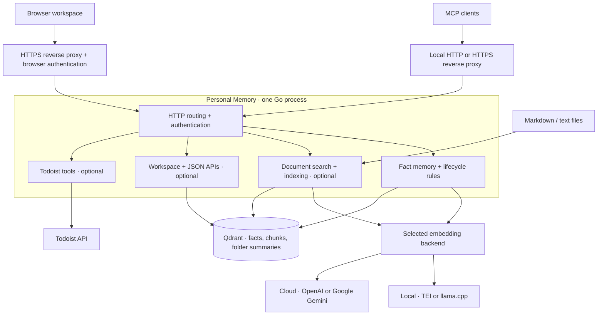

# Personal Memory

**A memory layer your AI clients can share — and you can inspect.**

Keep project decisions, personal preferences, and useful context beyond a single
conversation. Personal Memory gives MCP-compatible assistants a shared place to
save facts and find them again, alongside search over your Markdown knowledge
base. You own the service, choose where embeddings run, and can review what the
assistant remembers in a browser.

[Documentation](https://dzarlax-ai.github.io/personal_memory/) ·
[Get started](#get-started) ·
[Architecture](#architecture) ·
[Embedding backends](#local-and-cloud-embeddings)

## What it looks like in practice

You tell an assistant, “Our mobile app must work offline.” It can save that as a
project fact. In a later session, another connected client can retrieve it when
you discuss the app's architecture. When the decision changes, the old fact can
be marked historical or superseded, while ordinary recall uses current context.

For longer material, keep the original Markdown files in your knowledge base.
Document search returns relevant passages and relative file paths. The dashboard
lets you inspect facts, explore similar entries, browse indexed documents, and
review AI-generated project-description proposals.

The client still needs instructions to use memory: connecting an MCP endpoint
makes tools available; the [client integration bundle](https://dzarlax-ai.github.io/personal_memory/integration-bundle/guide/)
provides the policy for when to recall, save, and keep tasks in Todoist.

## What you can do

| Capability | How it helps |
| --- | --- |
| **Remember across sessions** | Store and retrieve facts with namespaces, tags, provenance, and expiry. |
| **Keep current context clear** | Distinguish current, historical, superseded, and disputed facts; inspect history explicitly. |
| **Search your documents** | Incrementally index Markdown/text files and search chunks directly or through folder summaries. |
| **See what is stored** | Use the Memory, AI Updates, Quality, and Documents workspace, with graph and timeline views for exploration. |
| **Choose your embedding backend** | Run TEI or llama.cpp locally, or explicitly select OpenAI or Google Gemini; facts and documents can use separate profiles. |
| **Connect task tools** | Enable a separate Todoist MCP endpoint with its token kept on the server. |
| **Maintain your data** | Export facts, take Qdrant snapshots, and use explicit maintenance and migration workflows. |

Document search, the browser workspace, Todoist, and optional AI features are
separately configured. The basic fact-memory service works without a generative
model or AI catalog.

## Architecture

One Go service exposes the MCP tools and serves the browser workspace. Qdrant
stores vectors and their payloads. An embedding backend turns text into vectors;
it does not store the facts or decide which facts are current.



**The two main data paths:**

1. **Facts:** `store_fact` embeds the text and checks for duplicates before
   storing a vector and metadata. `recall_facts` embeds the query, retrieves
   semantic candidates, and applies lifecycle rules. Similarity is a retrieval
   signal; it does not establish a contradiction or make a fact authoritative.
2. **Documents:** the indexer splits source files into chunks and builds folder
   summaries. Unchanged files are skipped. Search uses the configured flat or
   hierarchical route and returns passages with paths relative to the document
   root. The standalone indexer can run separately from the server.

### Where things live

| Layer | Contents |
| --- | --- |
| **Qdrant collections** | Fact text, tags, lifecycle metadata, and vectors; separate collections for document chunks and folder summaries. Profile bindings can select different collection names. |
| **Document directory** | Your original files, mounted into the server/indexer for document search. |
| **Optional AI state and catalog** | Project descriptions, proposals, publication history, and maintenance run records on persistent disk. |
| **Client integration** | Client-side policy and instructions installed by the versioned integration bundle. |

The browser workspace is served by the Go binary; no separate frontend server is
needed. Its graph connects facts by vector similarity, so an edge means semantic
proximity, rather than a verified entity relationship.

### Optional AI and project descriptions

Embeddings support ordinary semantic search. Separately enabled AI features can
propose project groupings for new facts, rank recall candidates, or maintain
project descriptions. **AI Updates** exposes proposal comparisons, evidence,
assessments, run diagnostics, and published description history.

These features are experimental and disabled by default. Catalog maintenance
publishes through review by default; an explicit evidence-bounded policy can
allow automatic publication. Provider access, data-egress permissions, and
budgets are configured independently of embedding selection. See
[optional AI memory features](https://dzarlax-ai.github.io/personal_memory/operations/optional-ai/)
for the exact controls and limitations.

### Connections and trust boundaries

`/memory` is the Streamable HTTP MCP endpoint. Optional document tools use that
same endpoint; Todoist uses `/todoist`, and the browser workspace uses `/viz/`.
The local release binds unauthenticated access to loopback. Remote installations
require authentication; Qdrant and local model servers stay on internal networks.

The native MCP endpoint supports API-key and optional OAuth authentication. An
optional Cloudflare Access profile provides `/memory/oauth`; browser access has
its own audience checks and also requires the application-verified proxy secret.
See [Architecture and security](https://dzarlax-ai.github.io/personal_memory/architecture-security/)
and the [Access migration guide](https://dzarlax-ai.github.io/personal_memory/operations/cloudflare-access/)
for deployment-specific details.

Before opening its listener, the application verifies the embedding identity of
every active collection. Cloud profiles send the selected input to that provider;
there is no automatic cross-provider fallback. Switching models requires matching
collections and an explicit migration, rather than relabeling existing vectors.

## Get started

The quickest path is a local Docker installation with TEI embeddings. The
agent-assisted and manual paths below use version-bound release assets. For an
existing installation, read [Upgrade and rollback](https://dzarlax-ai.github.io/personal_memory/operations/upgrade-rollback/)
before changing the running version or embedding configuration.

### Ask Codex or Claude Code to set it up

For a new local installation, paste this into Codex or Claude Code:

```text
Install a new local Personal Memory service and connect this client by following
https://github.com/Dzarlax-AI/personal_memory/releases/latest/download/agent-setup.md
Show me the exact release and planned changes before writing anything. Stop at
every reconnect required by the playbook, and do not claim completion until a
fresh session loads the installed policy, discovers all required tools, and
get_stats succeeds.
```

The released guide is bound to one stable version and uses only its matching
Compose file, integration binary, and checksums. It writes a privacy-safe
checkpoint, stops after client-native MCP registration, resumes for real tool
discovery and bundle installation, then requires a final fresh session to load
and verify the policy. The automated local flow is Memory-only. If you need
Documents, stop before setup and use a
RAG-enabled service plus the [manual client guide](https://dzarlax-ai.github.io/personal_memory/getting-started/connect-clients/).

For a reproducible older release, replace `releases/latest/download` in the
prompt with `releases/download/vX.Y.Z`. Read the complete
[agent-assisted setup explanation](https://dzarlax-ai.github.io/personal_memory/getting-started/installation/),
or use the manual path below.

### Or start the local service yourself

The local release needs only Docker Engine or Docker Desktop with Docker Compose v2. It uses published images, stores data in named volumes, and exposes only `http://127.0.0.1:8000/memory`. It needs no repository clone, build, Traefik, domain, `.env`, or API key.

Choose the asset for your CPU (`amd64` for Intel/AMD, `arm64` for Apple Silicon or ARM64 Linux):

```bash
mkdir personal-memory
cd personal-memory
curl -fsSLO https://github.com/Dzarlax-AI/personal_memory/releases/latest/download/compose.local-arm64.yaml
curl -fsSLO https://github.com/Dzarlax-AI/personal_memory/releases/latest/download/SHA256SUMS
if command -v shasum >/dev/null 2>&1; then
  grep 'compose.local-arm64.yaml' SHA256SUMS | shasum -a 256 -c -
else
  grep 'compose.local-arm64.yaml' SHA256SUMS | sha256sum -c -
fi
mv compose.local-arm64.yaml compose.yaml
docker compose pull
docker compose up -d memory-qdrant memory-embeddings
```

For Intel/AMD, replace both occurrences of `arm64` with `amd64`. The first embedding-model download can be slow. Observe it without restarting it:

```bash
docker compose ps --format json memory-embeddings
docker compose logs --tail 50 memory-embeddings
```

When `memory-embeddings` is healthy, start the application with a short bounded wait:

```bash
docker compose up -d --wait --wait-timeout 120 memory-mcp
curl -fsS http://127.0.0.1:8000/health
# ok
```

Do not change the published port to a non-loopback address: this intentionally unauthenticated mode is safe only on `127.0.0.1`. See the full [local installation instructions](https://dzarlax-ai.github.io/personal_memory/getting-started/installation/) for Windows download commands, resume behavior, stop, diagnostics, and rollback.

## Production baseline

The checked-in Compose stack is production-oriented: it expects Docker, an external `traefik` network, HTTPS-capable Traefik, DNS for `mcp.<domain>`, and writable Qdrant data/snapshot directories.

```bash
git clone https://github.com/Dzarlax-AI/personal_memory.git
cd personal_memory
sudo mkdir -p /root/memory/qdrant_storage /root/memory/qdrant_snapshots
docker network inspect traefik >/dev/null
cp .env.example .env
openssl rand -hex 32
```

Set `MEMORY_DOMAIN`, put the generated secret in `API_KEY`, and keep `ALLOW_INSECURE_AUTH=false`. The checked-in Compose file uses `:latest`, so select a reviewed immutable image before first start:

```bash
# Replace the example tag with the reviewed published sha-* tag.
cat > compose.release.yml <<'EOF'
services:
  memory-mcp:
    image: ghcr.io/dzarlax-ai/personal-memory:sha-0123456789abcdef
EOF
docker compose -f docker-compose.yml -f compose.release.yml config
docker compose -f docker-compose.yml -f compose.release.yml pull
docker compose -f docker-compose.yml -f compose.release.yml up -d
docker compose -f docker-compose.yml -f compose.release.yml ps
curl -fsS https://mcp.example.com/health
# ok
```

Connect clients to `https://mcp.example.com/memory` with `X-API-Key` or a Bearer API key. Todoist uses a distinct `/todoist` endpoint and needs explicit enablement.

See [Upgrade and rollback](https://dzarlax-ai.github.io/personal_memory/operations/upgrade-rollback/) for local and production rollback procedures.

## Local and cloud embeddings

The server and standalone indexer support these explicit backend profiles:

| Location | Provider | Supported models | Input profile |
| --- | --- | --- | --- |
| Local | TEI | `intfloat/multilingual-e5-small` | `legacy-raw-v1` or `multilingual-e5-v1` |
| Local | llama.cpp | `embeddinggemma-2` | `embeddinggemma-search-v1` |
| Cloud | OpenAI | `text-embedding-3-small`, `text-embedding-3-large` | `openai-text-v1` |
| Cloud | Google | `gemini-embedding-2`, `gemini-embedding-001` | `gemini-embedding-2-search-v1`, `gemini-embedding-001-task-v1`, respectively |

Without `EMBED_PROFILES_FILE`, the existing local TEI setup uses the legacy
`EMBED_*` variables and collection names. The manual local-release setup above
continues to use that path. Published release assets are version-bound; choose an
application revision that includes backend profiles before using the advanced
configuration.

For backend selection, start with the checked-in
[profile examples and migration guide](docs/examples/embedding-backends/README.md)
and [example JSON](docs/examples/embedding-backends/profiles.json). Mount the JSON
read-only and set `EMBED_PROFILES_FILE` to its **container path** in both the
server and standalone indexer. `bindings.memory` selects a profile and fact
collection; `bindings.rag` selects a profile, chunk/folder collections, and an
explicit `flat` or `hierarchical` search mode. Facts and documents can use
different profiles. The example deliberately keeps E5 active.

Only active cloud profiles read the secret named by `api_key_env`; keep its value
outside the JSON and source control. Inactive profiles do not probe providers or
read keys. Cloud use sends the selected fact, query, or document input to that
provider and needs explicit permission for that data. There is no automatic
cross-provider fallback.

For a new vector space, prepare new matching collections before switching
bindings. Nonlegacy memory bindings require calibrated `dedup`, `related`,
`mutation`, and `viz` thresholds plus a recorded `basis`; nonlegacy hierarchical
RAG also requires `folder_threshold`. Existing vectors cannot be relabeled as a
new provider, model, dimension, normalization, or input profile. Use the
[manifest-bound migration and rollback procedure](docs/examples/embedding-backends/README.md#migration-on-the-data-host)
for an existing installation. Preserve the old collections; after new writes,
rollback must transfer the current data rather than select stale collections.

## Development

```bash
make dev-deps   # fetches embedded browser assets
make test       # assets, vet, tests, and binaries
make docs-install
make docs-check
make docs-build
```

Documentation targets are separate from `make test`; ordinary Go checks do not download Node dependencies.

## Documentation

The public documentation is available at [dzarlax-ai.github.io/personal_memory](https://dzarlax-ai.github.io/personal_memory/). Contributors can edit its canonical source in [`website/src/content/docs`](website/src/content/docs).

- [Installation](https://dzarlax-ai.github.io/personal_memory/getting-started/installation/)
- [Connect clients](https://dzarlax-ai.github.io/personal_memory/getting-started/connect-clients/)
- [Upgrade and rollback](https://dzarlax-ai.github.io/personal_memory/operations/upgrade-rollback/)
- [Backups and releases](https://dzarlax-ai.github.io/personal_memory/operations/backups-release/)
- [Troubleshooting](https://dzarlax-ai.github.io/personal_memory/operations/troubleshooting/)
- [Fact lifecycle](https://dzarlax-ai.github.io/personal_memory/lifecycle/fact-lifecycle-contract/)
- [Lifecycle migration](https://dzarlax-ai.github.io/personal_memory/lifecycle/migration/)
- [Maintenance](https://dzarlax-ai.github.io/personal_memory/maintenance/)
- [MCP tools](https://dzarlax-ai.github.io/personal_memory/reference/tools/)
- [Configuration](https://dzarlax-ai.github.io/personal_memory/reference/configuration/)
- [Compatibility](https://dzarlax-ai.github.io/personal_memory/reference/compatibility/)
- [Architecture and security](https://dzarlax-ai.github.io/personal_memory/architecture-security/)
- [Limitations](https://dzarlax-ai.github.io/personal_memory/limitations/)
- [Client integration bundle](https://dzarlax-ai.github.io/personal_memory/integration-bundle/guide/)
- [Retrieval evaluation](https://dzarlax-ai.github.io/personal_memory/operations/evaluation/)
- [Conformance suite](https://dzarlax-ai.github.io/personal_memory/operations/conformance/)
